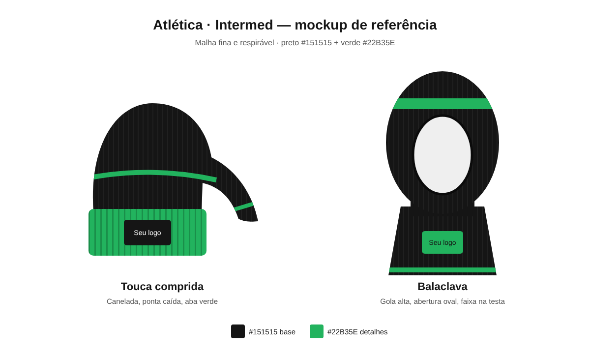

# Briefing para geração de imagens: toucas e balaclavas da atlética de medicina



`mockup.png` / `mockup.svg`: mockup plano em preto e verde para anexar como
referência de forma e cores (passo 1 de "Como usar").

## Contexto
Merchandising para a atlética de uma faculdade de medicina brasileira, para uso
no Intermed (torneio intermedical), que costuma acontecer em Vassouras/Valença
(RJ). Clima da região: quente e úmido no verão, com pancadas de chuva à tarde;
no inverno é seco, com manhãs frias (mínima em torno de 14 °C). Por isso as
peças devem ser de malha fina e leve, respirável, com opção de proteção UV.

## Paleta
- Preto (base): `#151515`
- Verde (detalhes): `#22B35E`
- Não usar nenhum brasão, logo ou nome de universidade existente. Deixar um
  espaço neutro escrito "Seu logo" para aplicar depois.

## Produto 1: touca comprida
- Touca longa de malha canelada, preta, com ponta caída para o lado.
- Aba (bainha) em verde com canelado vertical.
- Uma listra verde fina em volta da cúpula e outra na ponta caída.
- Pequeno patch preto na aba com espaço para o logo.

## Produto 2: balaclava
- Balaclava de malha fina, preta, com gola alta e abertura oval para o rosto.
- Faixa verde na altura da testa e faixa verde fina na base da gola.
- Patch verde na gola com espaço para o logo.

## Prompts prontos (copie e cole)

### Foto de produto, touca
```
Foto de produto em fundo branco, estilo catálogo de loja universitária, iluminação de estúdio suave. Touca comprida de malha canelada preta com ponta caída para o lado, aba verde (#22B35E), listra verde fina em volta da cúpula e outra na ponta, pequeno patch preto na aba sem texto nem logo. Tecido leve, ângulo de 3/4, alta resolução.
```

### Foto de produto, balaclava
```
Foto de produto em fundo branco, estilo catálogo de loja universitária, iluminação de estúdio suave. Balaclava de malha fina preta com gola alta e abertura oval para o rosto, faixa verde (#22B35E) na altura da testa, faixa verde fina na base da gola, patch verde na gola sem texto nem logo. Peça vista de frente, em manequim invisível (ghost mannequin), alta resolução.
```

### Foto de uso (lifestyle)
```
Jovem universitário brasileiro numa arquibancada de ginásio ao ar livre de manhã cedo, com neblina leve, usando a touca comprida preta e verde. Estilo foto de campanha de moda esportiva, luz natural suave, profundidade de campo rasa.
```

## Como usar
1. Anexe o `mockup.png` (ou o mockup que você gerou no Claude) como referência
   de forma e cores.
2. Cole um dos prompts acima.
3. Peça variações: "mesmo produto, mas com listras maiores" ou "mesmo produto
   em dry-fit com proteção UV".
4. Depois de aprovar a imagem, aplique o logo real da atlética no Canva ou no
   Figma, para sair nítido.

## Observações
- Se o Intermed for no verão, priorize malha fina ou dry-fit; se for no
  inverno, malha um pouco mais grossa com forro.
- Evite pedir à IA para escrever o nome da atlética; ela costuma errar as letras.
